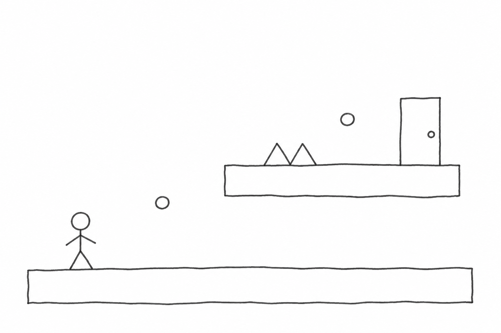
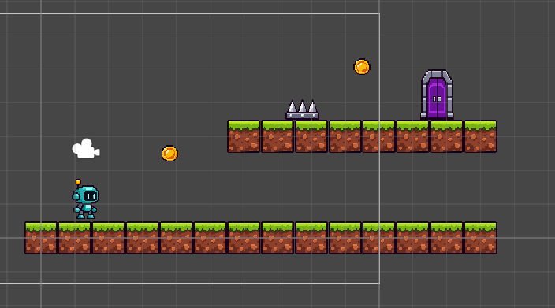
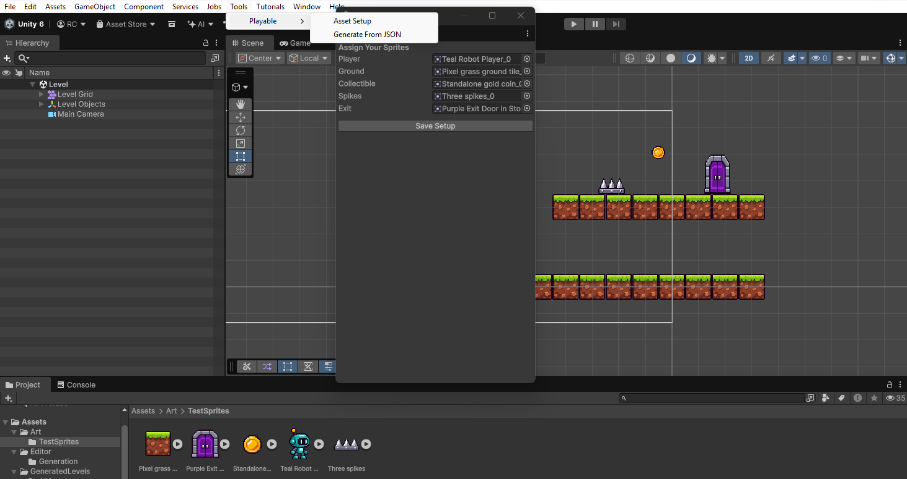
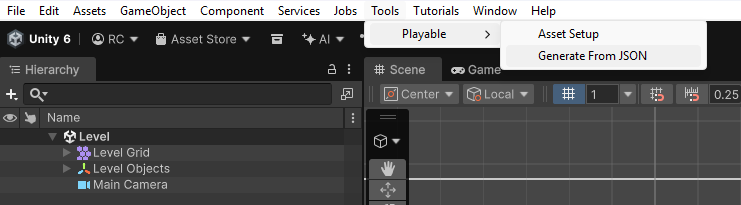

# Playable

**Draw a level. Turn it into something playable.**

Playable is a work-in-progress tool that connects hand-drawn 2D platformer layouts to Unity. A drawing describes the terrain, player spawn, collectibles, spikes, and exit. A computer vision model detects these elements and then produces a structured JSON layout to Unity's level generator.

The complete pipeline currently works as a prototype, with prediction, JSON export, and Unity import running separately.

### Example

The image below shows the whiteboard drawing:


The image below shows the generated Unity scene with a tiled main floor, an elevated platform, a player, collectibles, spikes, and an exit:


## Features

- Detect five types of level elements from a drawing.
- Convert rectangular platforms into editable Unity Tilemap cells.
- Position objects above platforms using a shared coordinate system.
- Generate a player, collectibles, hazards, and an exit with their gameplay components.
- Preview model predictions before generating a scene.

## Tech stack

| Tool | Role |
|---|---|
| Python | Dataset preparation, model training, inference, and planned JSON export |
| PyTorch | Tensors, GPU execution, optimization, and saving model weights |
| TorchVision | Pretrained Faster R-CNN, image decoding, bounding boxes, and joint transforms |
| pandas / NumPy | Reading CSV annotations and preparing coordinates |
| Matplotlib | Comparing images, annotations, and predictions |
| Make Sense | Manual image annotation |
| Unity / C# | Scene generation and runtime gameplay |
| Unity Tilemap | Grid-based terrain and collision |
|---|---|


## How it works

1. **Create a drawing.** Use rectangles for terrain, a stick figure for the player, circles for collectibles, triangles for spikes, and a door for the exit.
2. **Detect the objects.** Faster R-CNN predicts a class, bounding box, and confidence score for each element.
3. **Clean the predictions.** Filter low-confidence detections, remove duplicate terrain boxes, and suppress collectibles detected inside doors.
4. **Export the level.** Convert pixel coordinates into Unity coordinates and expand terrain rectangles into grid cells.
5. **Generate the scene.** Import the JSON in Unity to create terrain and gameplay objects.


### Drawing convention

| Drawing | Dataset label | Class ID | Intended game element |
|---|---|---:|---|
| Complete stick figure | `player` | 1 | Player |
| Circular coin | `collectible` | 2 | Coin |
| Connected group of triangular spikes | `spikes` | 3 | Obstacle |
| Rrectangular door | `exit` | 4 | Level exit |
| Outlined rectangular platform/floor | `terrain` | 5 | Occupied terrain cells |

## Dataset and training

The development dataset contains **130 drawings with 1,114 object annotations**.

| Label | ID | Drawing |
|---|---:|---|
| player | 1 | Stick figure |
| collectible | 2 | Circle |
| spikes | 3 | Group of triangles |
| exit | 4 | Door |
| terrain | 5 | Rectangular floor or platform |

Class 0 is reserved for background. Each object has its own bounding box; a connected spike group is treated as one object.

Annotations use this CSV format:

```csv
label_name,bbox_x,bbox_y,bbox_width,bbox_height,image_name,image_width,image_height
```

A custom PyTorch Dataset loads each image with all its annotations and converts boxes from x/y/width/height into xmin/ymin/xmax/ymax. TorchVision v2 transforms update images and boxes together.

Training fine-tunes a pretrained Faster R-CNN model with a new prediction head for the five classes plus background. 

The pipeline uses the following transforms:

1. `ToImage()` to identify the image tensor.
2. `RandomHorizontalFlip(p=0.5)` for left/right variation.
3. `SanitizeBoundingBoxes()` to remove invalid boxes and matching labels.
4. `ToDtype(torch.float32, scale=True)` to scale pixels from 0–255 to 0–1.

The pipeline uses SGD, a learning-rate scheduler, validation after each epoch, and saved model checkpoints.

The initial SGD configuration is:

| Parameter | Value |
|---|---:|
| Learning rate | 0.005 |
| Momentum | 0.9 |
| Weight decay | 0.0005 |


## Recorded results

The reported final epoch of the 30-epoch run produced the following metrics on **30 evaluation images**:

| Metric | Value |
|---|---:|
| Bounding-box mAP, IoU 0.50–0.95 | 0.675 |
| AP at IoU 0.50 | 0.991 |
| AP at IoU 0.75 | 0.688 |
| Average recall, IoU 0.50–0.95, max 100 detections | 0.757 |


## Converting predictions into a level

The postprocessing script reads the cleaned predictions from `backend/data/predictions.csv` and writes `backend/data/output.json`.

The JSON separates terrain cells from objects:

```json
{
  "schemaVersion": 1,
  "levelName": "ExampleLevel",
  "terrain": [
    { "x": 0, "y": 0 },
    { "x": 1, "y": 0 },
    { "x": 2, "y": 0 }
  ],
  "objects": [
    { "type": "player", "x": 0, "y": 1.15 },
    { "type": "collectible", "x": 2, "y": 2 }
  ]
}
```

Terrain coordinates represent cell centres. Object coordinates represent object centres.

## Project structure

```text
backend/
  preprocess.py       # Dataset, training, and evaluation
  predict.py          # Saved-model inference and prediction previews
  postprocess.py      # Prediction cleanup and JSON export
  data/               # Images, annotations, predictions, and level JSON
  models/             # Trained model checkpoints
  references/         # TorchVision detection training helpers
samples/              # Example level JSON files
unity/Assets/
  Editor/             # Asset setup and scene generation tools
  Scripts/            # Level data, asset profile, and gameplay scripts
```

## Running the project

### Python backend

Install a compatible PyTorch and TorchVision pair for your CPU or GPU using the [PyTorch installation guide](https://pytorch.org/get-started/locally/). Install the other dependencies:

```bash
python -m pip install pandas numpy matplotlib Pillow pycocotools
```

Place images and their annotation CSV files in the configured training and validation folders under `backend/data/`. Update paths in the scripts to match your files.

Train the model:

```bash
python backend/preprocess.py
```

Select a saved checkpoint under `backend/models/` and an input image in the prediction script, then run:

```bash
python backend/predict.py
```

Run the postprocessing script on the saved predictions to produce `backend/data/output.json`.

### Unity

1. Open the project in the `unity/` folder.
2. Assign and save the sprites through **Tools → Playable → Asset Setup**.


3. Open **Tools → Playable → Generate From JSON** and select the exported JSON.

4. Inspect the generated scene and enter Play mode.

Terrain can be edited through Unity's Tilemap tools. Currently, regenerating creates a fresh scene rather than merging manual edits.

## Current limitations and next steps

- Test and train on more whiteboard drawings and drawing styles to improve accuracy of the model.
- Support terrain beyond rectangles and improve floor selection for unusual layouts.
- Combine prediction, export, and generation into a simpler workflow.
- Check generated layouts for reachable platforms and exits.
- Add support for regenerating a scene with manual edits merged into the new layout.

## References

- [TorchVision object detection tutorial](https://docs.pytorch.org/tutorials/intermediate/torchvision_tutorial.html)
- [TorchVision detection training helpers](https://github.com/pytorch/vision/tree/main/references/detection)
- [Make Sense annotation tool](https://www.makesense.ai/)

